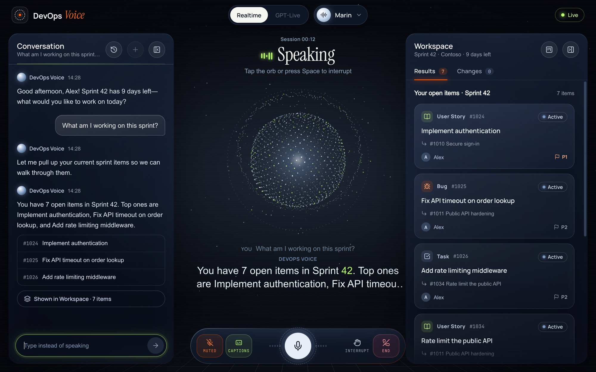
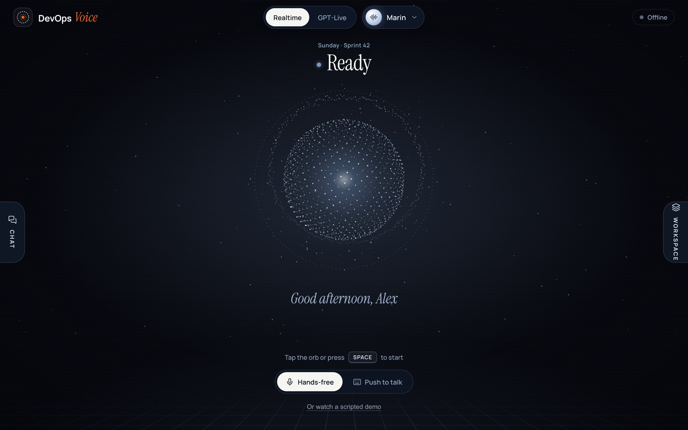
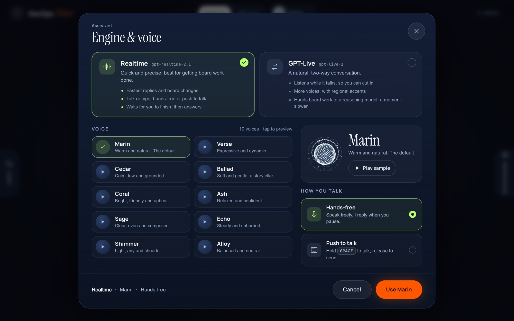
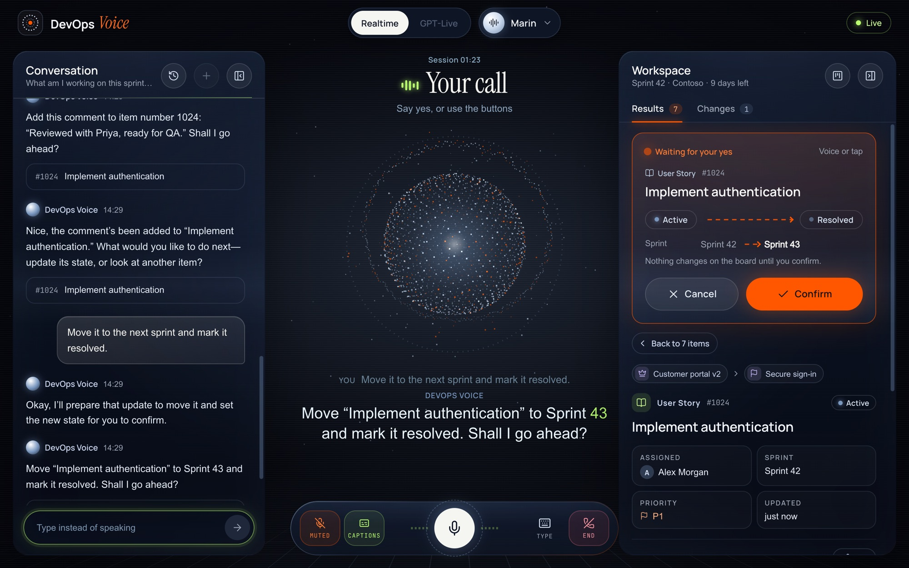
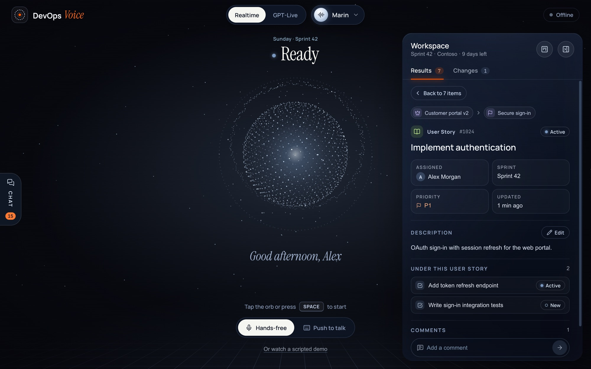
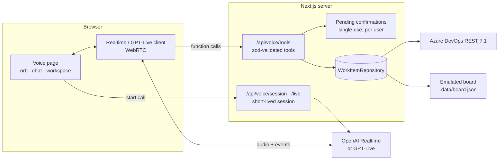

# DevOps Voice

**Talk to your Azure DevOps board.** Ask what you're working on, open a story and its parents, create tasks under the right parent, move work between sprints, write descriptions and comments, all hands-free. Nothing changes on the board until you say yes.



## Highlights

- **Voice first, two engines.** [OpenAI Realtime](https://platform.openai.com/docs/guides/realtime) (`gpt-realtime-2.1`) is the fastest and lets you type too. GPT-Live (`gpt-live-1`) is a natural full-duplex conversation that listens while it talks and hands board work to a reasoning model.
- **Every write is confirmed.** The assistant only ever *proposes* a change: create, update, comment, description or deleting a comment. You see a before → after preview and say "yes" (or tap Confirm). Confirmations are single-use, expire after 5 minutes, belong to the user who asked, and are refused if someone else changed the item since the preview.
- **Understands your board, not a template.** The process (Agile, Scrum, Basic, CMMI or a custom one like Epic → Initiative → Story → Task) is read from the project. "Story", "done", "next sprint" and teammates' first names map to that project's own types, states, sprints and people.
- **Puts work in the right place.** Tasks go under a story and follow its sprint, stories go under an initiative or feature, and portfolio items stay on the backlog. If a parent is missing, it suggests candidates instead of creating an orphan.
- **A workspace that shows what it heard.** Results appear as cards. Opening one shows its parent chain (each clickable), details, description, child items and comments. Changes animate in, and a session timeline keeps track of what happened.
- **22 voices with previews.** Pick an engine and voice and hear a sample before you choose.
- **Real Azure DevOps or a local emulator.** The same tools run against the Azure DevOps REST API (7.1) or a built-in emulated board, so you can try it without an Azure account.

| | |
|---|---|
|  |  |
| **Start:** tap the orb or press Space. The assistant greets you first. | **Engine & voice:** compare the engines and preview every voice. |
|  |  |
| **Your call:** a before → after preview that waits for your yes. | **Item detail:** parents, children, description and comments. |

## Quick start

Requires Node 20 or newer.

```bash
npm install
cp .env.example .env.local   # add OPENAI_API_KEY (or set VOICE_PROVIDER=azure and fill the AZURE_OPENAI_* values)
npm run dev                  # open http://localhost:3000/voice
```

`.env.example` starts on the **emulated board** (`BOARD_PROVIDER=emulated`), a local demo project with epics, features, stories, tasks, bugs and four sprints dated around today. No Azure DevOps account is needed. To see a full call without a microphone or API key, use **Or watch a scripted demo** on the start screen. It scripts the speech but runs the real tools against the emulated board.

Things to try:

- "What am I working on this sprint?"
- "Open the authentication story."
- "Create a task to add audit logging under it."
- "Move it to the next sprint and mark it in progress." Then: "Yes."
- "Write a good description for it." / "Add a comment: ready for QA." / "Delete that comment."

## How it works



1. **Starting a call.** The browser asks the server for a short-lived session (`/api/voice/session` for Realtime, `/api/voice/live` for GPT-Live), so permanent keys never leave the server. Starting a session also loads the board's context (process, sprints, team) and your current work, so the first question is answered from cache.
2. **Board work.** The model's function calls come back to the browser and are forwarded to `/api/voice/tools`, which validates every argument with zod and runs it against a `WorkItemRepository`.
3. **Writes.** `propose_*` tools return a preview and an `action_id`. Only `confirm_action` with that id, unexpired, from the same user, writes to the board. Azure updates carry a revision check, so a stale preview can't overwrite someone else's change.
4. **The screen.** Tool responses carry `uiEvents` (results, a preview, an item's detail, a change), and a reducer turns them into the workspace you see.

### Tools the assistant has

| Tool | What it does |
|---|---|
| `list_work_items` | Find items by assignee, sprint, state, type, parent or title words. With no arguments it lists your open items this sprint. |
| `get_work_item` | One item in full: parents up the hierarchy, children, latest comments. Opens it on screen. |
| `get_sprint` | Dates, days left, and how your items in a sprint are going. |
| `propose_create_work_item` | Preview a new item in the right sprint, under the right parent (found by id or by title words). |
| `propose_update_work_item` | Preview a change of state, title, priority, assignee, sprint, parent, tags, description, or a new comment. |
| `propose_delete_comment` | Preview removing one comment. |
| `confirm_action` / `cancel_action` | Apply or drop a previewed change, only after the user's yes. |

## Connecting Azure DevOps

1. In `.env.local` set `BOARD_PROVIDER=azure`, `AZURE_DEVOPS_ORG`, `AZURE_DEVOPS_PROJECT`, and `AZURE_DEVOPS_TEAM` if your team isn't called "&lt;project&gt; Team".
2. Sign in with **Microsoft Entra ID** (recommended). Each user signs in with their work account, and the board works as them, with their own Azure DevOps permissions.
   1. In the [Entra admin center](https://entra.microsoft.com) go to **App registrations → New registration**:
      - **Name:** DevOps Voice.
      - **Supported account types:** *Accounts in this organizational directory only*.
      - **Redirect URI:** *Web* → `http://localhost:3000/api/auth/callback/microsoft-entra-id`. Add your deployed URL's callback too.
   2. Under **Certificates & secrets**, create a client secret and copy its **value**.
   3. Under **API permissions → Add a permission → APIs my organization uses**, pick **Azure DevOps**, then **Delegated → user_impersonation**. Grant admin consent if your tenant requires it.
   4. Put the IDs in `.env.local`:

      ```bash
      AUTH_MICROSOFT_ENTRA_ID_TENANT_ID=<Directory (tenant) ID>
      AUTH_MICROSOFT_ENTRA_ID_ID=<Application (client) ID>
      AUTH_MICROSOFT_ENTRA_ID_SECRET=<client secret value>
      AUTH_SECRET=<output of: openssl rand -base64 33>
      ```

   With these set, every page and API needs a signed-in user, including the routes that start voice calls. Sign-in uses the authorization code flow with PKCE ([Auth.js](https://authjs.dev)).

   **Where the tokens live.** The user's Azure DevOps token and refresh token are kept only in an encrypted, HTTP-only session cookie. The browser's JavaScript never sees them. The server refreshes the token before it expires.

   **Per-user data.** Caches, saved conversations and pending confirmations are keyed by the user's Entra tenant and object id. The single hook for all of this is [`getAzureDevOpsCredential()`](src/lib/devops/azure/auth.ts).
3. **Without Entra settings** (local testing only), set `AZURE_DEVOPS_PAT` to a personal access token with *Work Items (Read & write)* and *Project and Team (Read)* scopes. Keep it in `.env.local`, which is git-ignored.

**Latency.** The project context is cached for 15 minutes, lists for 60 seconds and single items for 30 seconds, and every write clears what it touched. A list takes 2 to 3 requests, and a create or update is one JSON Patch request. Server logs show timings as `[ado] …` and `[tool] …`.

### Set up a demo project

[`scripts/azure_boards_setup.py`](scripts/azure_boards_setup.py) turns an empty project into a realistic test board. It creates:

- an Epic → Initiative → User Story → Task hierarchy;
- the states New, In Progress, On Hold, In Review and Completed;
- 12 two-week sprints, plus backlogs and board columns;
- about 270 work items across past, current and future sprints.

It's safe to re-run.

```bash
python3 -m pip install requests
python3 scripts/azure_boards_setup.py --plan   # preview, no connection
export AZDO_ORG=your-org
export AZDO_PAT=...                            # or leave unset to be prompted (input hidden)
python3 scripts/azure_boards_setup.py
```

## Configuration

All settings live in `.env.local`; [`.env.example`](.env.example) documents each one.

| Variable | Default | |
|---|---|---|
| `VOICE_PROVIDER` | `openai` | `openai` or `azure` (Azure OpenAI Realtime) |
| `OPENAI_API_KEY` | — | Server-side only; the browser gets short-lived sessions |
| `OPENAI_REALTIME_MODEL` | `gpt-realtime-2.1` | Realtime model |
| `REALTIME_VOICE` / `LIVE_VOICE` | `marin` | Default voices (users can pick their own in the app) |
| `TURN_DETECTION`, `VAD_*`, `NOISE_REDUCTION` | semantic, far field | When your turn ends, and how noise is handled |
| `LIVE_BACKEND_MODEL`, `LIVE_REASONING_EFFORT` | `gpt-6-luna`, `low` | The model GPT-Live hands board work to |
| `BOARD_PROVIDER` | `emulated` | `emulated` or `azure` |
| `AZURE_DEVOPS_ORG`, `_PROJECT`, `_TEAM`, `_PAT` | — | See *Connecting Azure DevOps* |
| `AUTH_MICROSOFT_ENTRA_ID_TENANT_ID`, `_ID`, `_SECRET`, `AUTH_SECRET` | — | Sign-in with Microsoft Entra ID (see above); `AUTH_URL` when not on localhost |
| `BOARD_CURRENT_USER` | `Demo User` | Who "me" is on the emulated board |

## Project structure

```
src/
  auth.ts                 Auth.js sign-in (Microsoft Entra ID)
  middleware.ts           requires sign-in when Entra ID is configured
  app/                    Next.js routes
    signin/               the sign-in page
    voice/                the voice page
    board/                a simple sprint board view
    api/voice/            session (Realtime), live (GPT-Live), tools, actions
    api/board/            board info and sprint data
    api/conversations/    saved conversations
  components/voice/       orb, call dock, chat, workspace, item detail, picker
  hooks/voice/            session state (useVoiceSession) and the workspace reducer
  lib/
    auth/                 Entra ID settings, token refresh, sign-in gating
    devops/               board model, process rules, tools, confirmations, caching
      azure/              Azure DevOps REST client, context loader, repository
    voice/                Realtime and GPT-Live clients, prompts, turn-taking, voices
    conversations/        conversation storage and resume
  types/                  shared event types
scripts/
  azure_boards_setup.py   create and seed a demo Azure DevOps project
  make-voice-samples.mjs  record the voice previews in public/voices
  reset-board.mjs         reseed the emulated board
  voice-test/             end-to-end voice tests with synthetic speech
docs/screenshots/         images for this README
```

## Testing

```bash
npm run check    # type-check + unit tests
npm test         # unit tests only (Vitest)
npm run build    # production build
```

The unit tests cover:

- process rules (types, states, sprints, people);
- the tools and the confirmation lifecycle, including expiry, single use and per-user ownership;
- the Azure DevOps adapter against a fake API (WIQL, batching, JSON Patch, revision checks, comments, retries and timeouts);
- caching, the auth hook, both voice clients (turn-taking, interruptions, overlapping GPT-Live hand-offs), session config, and the UI reducer.

GitHub Actions runs the type-check, tests and build on every push and pull request ([.github/workflows/ci.yml](.github/workflows/ci.yml)).

For end-to-end checks with real speech against the real voice service, see [scripts/voice-test](scripts/voice-test/README.md). It plays recorded scenarios into the app and reports what was heard, which tools ran, and how long each reply took.

## Security notes

- Sign-in with Microsoft Entra ID (optional): pages and APIs require a signed-in user, and the board acts with that user's own Azure DevOps permissions.
- API keys and Azure DevOps tokens stay on the server, in an encrypted HTTP-only cookie for user tokens. The browser only gets a short-lived voice session (Realtime), or talks through the server (GPT-Live).
- Every board write needs an explicit confirmation tied to the user who proposed it.
- `.env.local` and `.data/` (the emulated board and saved conversations) are git-ignored.

## Tech

Next.js 15 (App Router) · React 19 · TypeScript · Auth.js (Microsoft Entra ID) · Tailwind CSS 4 · zod · Vitest · WebRTC · OpenAI Realtime and GPT-Live · Azure DevOps REST API 7.1 · Lucide icons
